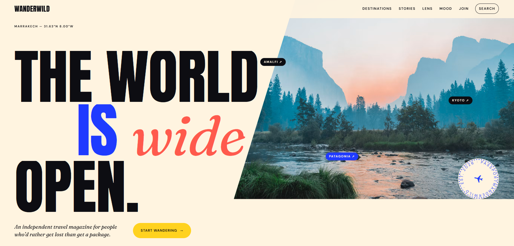

# Wanderwild | Premium Website Template

<!-- README SHOWCASE START -->

**Travel magazine & journal**

[**View Live Website (Vercel)**](https://wanderwild-template.vercel.app/) &nbsp;·&nbsp; [**GitHub Pages Demo**](https://mrpranavpatel.github.io/Wanderwild/) &nbsp;·&nbsp; [**Source Code**](https://github.com/MRPRANAVPATEL/Wanderwild)

    

*Preview screenshot of the website homepage.*

<!-- README SHOWCASE END -->

**Thoughtfully built by Pranav Patel.**

Immersive travel magazine and travel blog website template using HTML, CSS and JavaScript.

> **Portfolio / practice project:** Created for personal practice, design exploration and showcasing frontend development. This repository is a website template, not an operating store or publishing platform. Use and adapt at your discretion, and review asset rights and third-party dependencies before production use.

## About the template

Wanderwild is a polished, single-page frontend concept designed for travel blogs, destination magazines, adventure storytellers, and photography portfolios. It focuses on visual storytelling, considered typography and responsive interactions without requiring a frontend framework or build process.

## Features

- Editorial travel journal hero and destination discovery
- Filterable travel destinations and stories
- Photography galleries and travel mood exploration
- Interactive search, navigation and featured journal
- Newsletter form demonstration and mobile-friendly layouts

## Built with

- HTML5
- CSS3
- Vanilla JavaScript

## Run locally

1. Clone or download this repository.
2. Open `index.html` in your browser, or run it using VS Code Live Server.
3. No install, build process or package manager is needed.

## Live demo

- **Live demo (GitHub Pages):** https://mrpranavpatel.github.io/Wanderwild/
- **Vercel (live):** https://wanderwild-template.vercel.app/

## Deployment

This repository includes a root-level `index.html` and can be hosted as a static website on GitHub Pages or Vercel.

For GitHub Pages, open **Settings → Pages**, select **Deploy from a branch**, choose **main** and **/(root)**, and save. The live GitHub Pages demo is available at the link above.

## Important notes

This is a static frontend template. Editorial entries and newsletter interactions are demonstrations rather than a connected CMS or mailing platform.

External media, imagery and fonts may require an internet connection. Review licensing and replace demonstration content before commercial use.

## Author

Created by **Pranav Patel** as a personal frontend practice and portfolio project.

---

**Thoughtfully built by Pranav Patel.** Designed to explore modern web experiences, learn by building and turn creative concepts into practical frontend templates.
